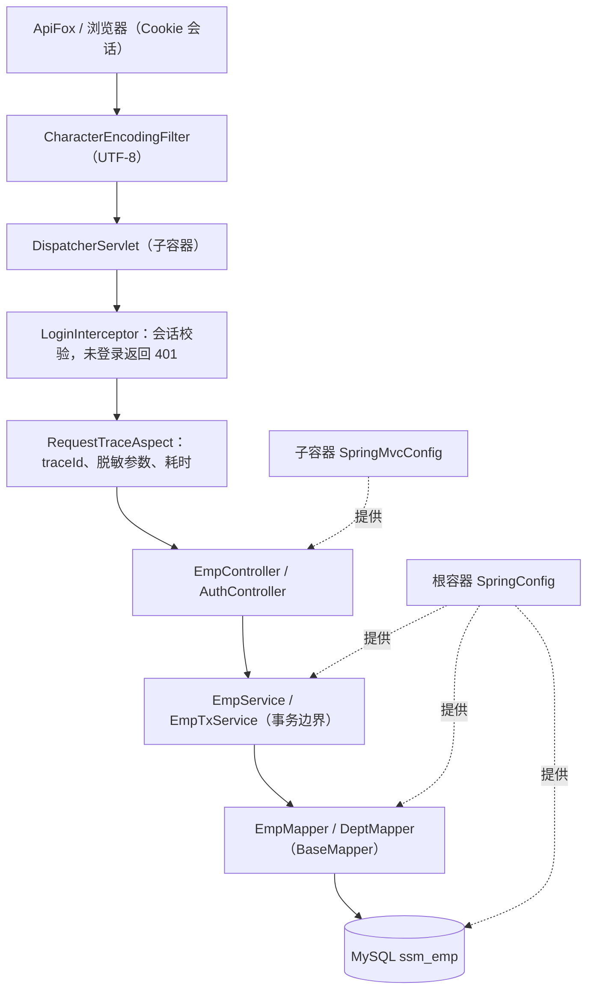

# EMP 管理 MIS 架构说明与接口清单

本文档对应实验二任务 7 的交付物「架构图与接口清单」，用于说明系统的分层边界、请求链路、接口契约与关键设计取舍，便于验收时快速定位实现位置。

## 一、技术栈与工程形态

| 层次 | 选型 | 版本 | 说明 |
|---|---|---|---|
| 构建 | Maven（war 打包） | 3.9.6 | 不使用 Spring Boot，依赖版本集中声明 |
| 容器 | Tomcat | 9.x | 外部容器部署 `emp-mis.war` |
| 表现层 | SpringMVC | 5.3.31 | 全注解，无 `web.xml`，`DispatcherServlet` 由 Java 配置注册 |
| 业务层 | Spring Framework | 5.3.31 | 根容器管理 Service、事务、切面 |
| 持久层 | MyBatis-Plus + mybatis-spring | 3.5.3.1 / 2.0.7 | `BaseMapper` 单表 CRUD，`PaginationInnerInterceptor` 分页 |
| 数据源 | Druid | 1.2.20 | 初始连接 5，最大 20 |
| 数据库 | MySQL | 8.0.33 | 库 `ssm_emp`，表 `emp`、`department` |
| 校验 | Hibernate Validator | 6.2.5.Final | 需额外引入 `javax.el` 做消息插值 |
| JSON | Jackson | 2.15.3 | 统一 `application/json` 输出 |
| 日志 | Logback + SLF4J | 1.2.12 | MDC 携带 traceId |
| 测试 | JUnit4 + spring-test + MockMvc | 4.13.2 / 5.3.31 | 31 个用例，覆盖整合、接口、事务 |

## 二、分层架构

- 根容器：`SpringConfig` 负责 Druid 数据源、`MybatisSqlSessionFactoryBean`、`@MapperScan`、`DataSourceTransactionManager`、`@EnableTransactionManagement`、`@EnableAspectJAutoProxy`，扫描 `service`、`common`、`aspect`。
- 子容器：`SpringMvcConfig` 负责 `@EnableWebMvc`、Controller 扫描、跨域、静态资源放行、拦截器注册，只扫描 `controller`。
- 容器入口：`WebInitConfig` 继承 `AbstractAnnotationConfigDispatcherServletInitializer`，把两个配置类分别注册为 root 与 servlet 容器，并注册 UTF-8 过滤器。

## 三、请求链路（以 `GET /emps` 为例）

1. 请求携带 `JSESSIONID` 进入 Tomcat，先经过 UTF-8 编码过滤器。
2. `DispatcherServlet` 查 `HandlerMapping`，命中 `EmpController#page`，组装拦截器链。
3. `LoginInterceptor#preHandle` 检查 Session 中的 `loginEmpId`，缺失则直接写 401 与统一 JSON，不再进入 Controller。
4. `RequestTraceAspect` 生成 10 位 `traceId` 写入 MDC，打印方法、URI 与脱敏后的查询参数。
5. Controller 校验分页区间与薪资区间，调用 `EmpService#pageQuery`；Service 用 `LambdaQueryWrapper` 按需拼接条件，`PaginationInnerInterceptor` 改写 SQL 追加 `LIMIT`。
6. 返回值经 Jackson 序列化为 `{code, message, data}`，切面记录耗时与响应状态，`MDC` 清理。

## 四、分层职责与约束

| 层 | 职责 | 禁止事项 |
|---|---|---|
| Controller | 路由、参数把关、统一返回封装 | 写业务分支、直接拼 SQL |
| Service | 业务规则、事务边界、条件组装 | 返回 `Result`、处理 HTTP 语义 |
| Mapper | 单表 CRUD 与条件查询 | 写业务判断、跨表复杂逻辑 |
| common | `Result`、`BusinessException`、全局异常 | 依赖 Controller 或 Service |
| aspect / interceptor | 横切关注点：日志、认证 | 修改业务返回值、吞异常 |

## 五、接口清单

统一返回：`{code, message, data}`；错误码 200 成功、400 参数不合法、401 未登录、404 资源不存在、500 未预期异常。除拦截器返回真实 HTTP 401 外，业务错误以 HTTP 200 + 业务码表达。

### 认证 `/auth`

| 方法 | 路径 | 入参 | 出参 | 说明 |
|---|---|---|---|---|
| POST | `/auth/login` | `{empName, password}` | `Result<Void>` | 仅允许 `status=1` 的在岗员工，成功后写入 `loginEmpId`、`loginEmpName` |
| POST | `/auth/logout` | 无 | `Result<Void>` | `session.invalidate()`，记录退出日志 |
| GET | `/auth/me` | 无 | `Result<{empId, empName}>` | 未登录返回 code 401，用于前端恢复登录态 |

### 员工 `/emps`

| 方法 | 路径 | 入参 | 出参 | 说明 |
|---|---|---|---|---|
| POST | `/emps` | `Emp` JSON | `Result<Void>` | JSR-303 校验：姓名、性别、薪资、状态、部门编号 |
| PUT | `/emps` | `Emp` JSON（含 `empId`） | `Result<Void>` | 缺少或非法 `empId` 返回 400；按主键更新非空字段 |
| DELETE | `/emps/{id}` | 路径 `id` | `Result<Void>` | `id<=0` 返回 400 |
| DELETE | `/emps` | `[1,2,3]` | `Result<Void>` | 空数组返回 400；`removeByIds` 单条 SQL 批量删除 |
| GET | `/emps/{id}` | 路径 `id` | `Result<Emp>` | `id<=0` 返回 400；不存在时 `data=null` |
| GET | `/emps` | `page`、`size`、`name`、`gender`、`dept`、`minSalary`、`maxSalary` | `Result<IPage<Emp>>` | `page>=1`，`size` 1~100；`minSalary>maxSalary` 返回 400；`name` 模糊，其余等值或区间；固定按 `emp_id` 倒序 |

### 探针 `/probe`

| 方法 | 路径 | 说明 |
|---|---|---|
| GET | `/probe/ping` | 仅测试作用域内的轻量探针，验证 MVC 链路可达，生产环境不注册 |

## 六、数据模型

`emp`：`emp_id`（主键、自增）、`emp_name`、`gender`、`dept`、`post`、`salary`、`hire_date`、`status`、`dept_id`。索引：`idx_emp_name`（姓名模糊）、`idx_emp_dept_id`（部门关联）、`idx_emp_status`（在岗过滤）。
`department`：`dept_id`（主键）、`dept_name`、`location`，与 `emp` 构成一对多；`Emp#department` 标注 `@TableField(exist = false)`，仅在需要联表时装配。

## 七、关键设计取舍（与常见示例实现的差异）

1. **校验异常不在方法内消化**：Controller 使用 `@RequestBody @Valid`，不追加 `BindingResult`，由 `@RestControllerAdvice` 统一转 400，减少重复分支。
2. **拦截器返回真实 401**：不使用 HTTP 200 包一段提示文本，便于 ApiFox 按状态码断言、前端统一跳转登录。
3. **权限路径白名单化**：`/auth/**`、`/probe/**`、`/error` 与静态资源放行，避免登录接口被自身拦截。
4. **分页插件显式注册**：`MybatisPlusInterceptor` 必须 `setPlugins` 到 `SqlSessionFactory`，否则分页参数被忽略。
5. **日志切面只拦 Controller**：Service 与 Mapper 不再重复打印；`password/pwd/token` 脱敏输出，慢请求 500ms 转 WARN。
6. **事务验证用真实业务载体**：部门批量迁移，任一条员工缺失即整体回滚，并用异常被吞、自调用、private 注解三组对比说明代理边界。
